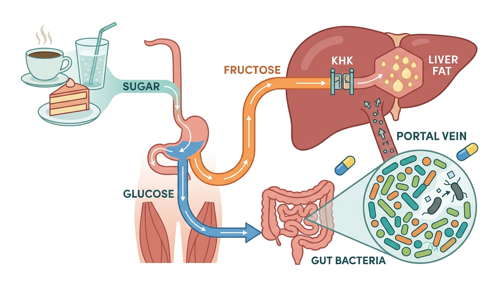

::: justify-text
**Hello everyone!**\
Welcome to my blog 🎉\
Today, I want to step slightly outside our regular series and talk about something that sits on almost every kitchen table in the world: sugar, and what two brand new studies tell us about how it reaches the liver.\

*Sugar was once a medicine, then a luxury, and is now an everyday habit. Our livers are still catching up with that journey.*\

Think about how many times sugar quietly enters your day. The spoonful in your morning tea or coffee. The biscuit that comes with it. The glass of packaged juice that feels healthy. The fizzy drink with lunch. The slice of cake that turns up for every birthday, promotion and farewell at work. Sugar is not just food. Across almost every culture, it is hospitality, celebration and love.\

That is exactly why it deserves an honest look. This month, two papers in the *Nature* family of journals added new pieces to the sugar story, and I think they are worth unpacking together.\

**A sweet story that began long ago**\
Here is something many people do not know: the earliest known production of crystal sugar emerged in South Asia, and the technique later spread through Persia, the Middle East and Europe. Sugarcane itself was first domesticated thousands of years ago in New Guinea, but for a long time people simply chewed the cane or drank its juice. It was in South Asia, roughly 1,500 to 2,000 years ago, that people worked out how to boil the juice and turn it into solid granules that could be stored, carried and traded.\

You can still hear that history in our words. The Sanskrit *sharkara*, meaning grit or gravel, travelled through Persian and Arabic and became "sugar" in English. The Sanskrit *khanda*, a lump of crystallised sugar, is the root of the word "candy". Every time someone asks for sugar in their coffee, anywhere in the world, they are, without knowing it, speaking a few syllables of an ancient language.\

For most of history, sugar was rare. Physicians across Asia and the Middle East used it as a medicine, and in medieval Europe it was so expensive it was called "white gold" and locked away like spice. That changed from the 1600s onwards, when vast plantations in the Americas, built on the forced labour of enslaved people, turned sugar into a cheap commodity. Later, industrial refining and, in the twentieth century, sweetened drinks and processed foods made it something we eat every day, often without noticing.\

So in evolutionary terms, our bodies met sugar as an occasional treat and now receive it in daily, concentrated doses. The organ that feels this change most is the liver.\

**One spoon, two sugars**\
To understand the new research, we need one small piece of chemistry. Table sugar (sucrose) is actually two simpler sugars joined together: **glucose** and **fructose**. When you digest it, the two separate and go their own ways.\

Glucose is the body's universal fuel. Your brain, muscles and almost every cell can use it, and its use is carefully controlled by insulin.\

Fructose is different. Most cells use very little of it. Instead, the gut and the liver do the bulk of the work, and so they carry most of the burden of processing it. Studies in mice have shown that the small intestine can process modest amounts of fructose, but when a large amount arrives quickly, as with a sugary drink, the excess spills over to the liver (Jang et al., 2018).\

Inside the liver, the first step in breaking down fructose is carried out by an enzyme called **ketohexokinase**, or KHK. Think of KHK as the entry gate to a factory. The important point is that this gate has very little in the way of a brake. Glucose metabolism has checkpoints that slow things down when the cell has enough. Fructose largely bypasses them. So when a lot of fructose arrives, the liver processes it quickly, and a good share of it is turned into new fat, a process called *de novo lipogenesis* (literally "making fat from scratch").\

This is one reason high sugar intake, and sugary drinks in particular, has been linked again and again to **MASLD** (metabolic dysfunction-associated steatotic liver disease), the condition where fat builds up in the liver, and its more serious, inflamed form, **MASH** (metabolic dysfunction-associated steatohepatitis).\

<figure style="width: 90%; max-width: 900px; margin: 2em auto; display: block; text-align: center;">
  
  <figcaption style="font-size: 0.85em; text-align: center; margin-top: 0.6em; color: #888; font-family: 'Source Sans 3', sans-serif;">
    Sugar may reach the liver by two routes: directly, as fructose that passes through the KHK gate and is turned into fat, and indirectly, by reshaping the gut bacteria that signal to the liver through the portal vein. 
    <em>Image created using Google Gemini</em>
  </figcaption>
</figure>\

**Study one: what happens when you close the fructose gate?**\
The first study, published in *Nature Metabolism* by Koene and colleagues at Maastricht University, asked a very direct question. If fructose metabolism in the liver is harmful, what happens if we switch off the gate?\

The team recruited 15 adults with MASLD in the Netherlands: nine men and six women, most of them in their late sixties or early seventies, carrying some extra weight, and none with type 2 diabetes. Each person took a drug called PF-06835919, which blocks KHK, for six weeks, and an identical-looking placebo tablet for another six weeks, with a five-week break in between. This is a double-blind *crossover* design: neither the volunteers nor the researchers knew which tablet was which, and everyone served as their own comparison.\

There is one detail of this trial I really like. To make sure the liver genuinely had fructose to deal with, the researchers topped up the volunteers' diets with sugar-sweetened drinks, so that everyone took in about 60 grams of fructose a day, an amount the authors note is common in many Western diets. Fourteen of the fifteen needed this top-up. The drug clearly did its job: far more unprocessed fructose appeared in the urine while people were taking it, a sign that the liver's fructose gate had been shut.\

The results were striking for such a short treatment. Liver fat fell in every single participant, by about 30% on average compared with placebo, and in 9 of the 15 people it dropped below the level used to define fatty liver. The authors point out that this is similar to what diet or exercise programmes achieve through weight loss. The share of saturated fat in the liver also fell, and the liver became better at responding to insulin. But the benefits did not stop at the liver. Muscle took up glucose more readily, fat tissue became more responsive to insulin, people burned more fat overnight, and uric acid levels in the blood came down. Adiponectin, a helpful hormone made by fat tissue that improves insulin sensitivity, rose in all fifteen volunteers.\

Here is the part I find most interesting: **body weight did not change**, and neither did body fat overall. These improvements were not simply the result of people losing weight. This matters, because many people develop fatty liver and insulin resistance at a "normal" weight, a pattern I have written about before on this blog. It suggests that *what* the liver is processing, and not only *how much* we weigh, shapes our metabolic health.\

How can blocking one enzyme in the liver help muscle and fat tissue elsewhere? The authors point to two kinds of messages the liver sends out. The first is VLDL, the particles the liver uses to export fat into the blood: on the drug, these shifted from large, fat-loaded particles towards smaller ones. The second is *hepatokines*, signalling proteins the liver releases to talk to other organs. Two hepatokines linked to fat production and insulin resistance, FGF21 and follistatin, went down, while SHBG, a protein whose low levels are linked to type 2 diabetes, went up. In other words, a liver handling a heavy flow of fructose appears to change the signals it sends out, in ways linked to poorer metabolic health elsewhere in the body. The study was not designed to prove which signal does what, but quieting the fructose pathway clearly shifted the conversation.\

This fits with earlier phase 2 trials of the same drug, which also found that it lowered liver fat in people with fatty liver disease (Kazierad et al., 2021).\

Now the honest caveats, and the authors are refreshingly open about them. Fifteen people for six weeks is a small and short study, designed to understand mechanism rather than to change practice. The volunteers were older (median age 72), were recruited in the Netherlands, and did not have diabetes, so we cannot assume the same results in younger people, in people with diabetes, or in other populations around the world. The benefits were seen against a background of high fructose intake, and the authors caution that the drug may have effects of its own that cutting sugar from the diet would not. The trial was funded by Pfizer, which makes the drug and supplied the tablets, and two authors are company employees, although the paper states the company had no role in data collection or analysis. And crucially, this drug is **not available** as a treatment. Please do not go looking for it. What this study gives us is not a pill, but careful human evidence that the fructose pathway itself is likely more than a bystander in the metabolic trouble seen in MASLD.\

**Study two: sugar, antibiotics and the gut**\
The second study, published in *Nature* by Dai and colleagues at Memorial Sloan Kettering Cancer Center in New York, comes from a very different corner of medicine, but I think it adds an important layer.\

The researchers followed 173 adults receiving bone marrow (stem cell) transplants. These patients often need strong, broad-spectrum antibiotics, which can badly damage the community of bacteria living in the gut, our *gut microbiome*. The team recorded more than 9,000 hospital meals and analysed over 1,000 stool samples to see whether diet changed how the microbiome responded to antibiotics.\

On its own, eating sweets was not linked to a less diverse microbiome. But when patients were on broad-spectrum antibiotics, eating more sugary foods was linked to a further fall in bacterial diversity, about 24% lower for every extra 100 grams of sweets. Sugar also went hand in hand with a bloom of *Enterococcus*, a type of bacterium that tends to take over when the healthy community is disturbed. Among patients with higher sugar intake, each extra day of broad-spectrum antibiotics was linked to a higher risk of death, a pattern not seen in those eating less sugar.\

The team then tested this in mice. Sugar alone did nothing to the gut bacteria. But sugar given alongside antibiotics made *Enterococcus* expand dramatically, more than 30-fold by day six. Glucose alone, fructose alone and even blended fruit purée had a similar effect in this setting.\

A useful way to picture this: a healthy microbiome is like a crowded, well-tended garden where weeds struggle to find space. Antibiotics clear large patches of that garden. Sugar, it seems, is fertiliser that the weeds get to first.\

Again, honesty matters. These were very ill patients, and the findings may not apply to healthy people taking a short course of antibiotics at home. The human findings are observational (they show association, not proof of cause), and the authors themselves call for proper trials before anyone changes clinical advice. **This study did not measure the liver at all.** So why am I including it in a post about MASLD?\

**Connecting the gut to the liver**\
Because the gut and the liver are directly plumbed together. Blood from the intestine travels through the *portal vein* straight to the liver before it goes anywhere else. Whatever the gut bacteria produce, and whatever leaks through a damaged gut lining, the liver sees first. Scientists call this the **gut-liver axis**.\

Earlier work has already shown that this connection matters for sugar. A 2020 study in *Nature* found that gut bacteria convert some dietary fructose into acetate, which then travels to the liver and is used as a building block for new fat (Zhao et al., 2020). Another study the same year showed that when the gut barrier is weakened and inflammation rises, fructose drives liver fat production more strongly (Todoric et al., 2020).\

So my reading, and I want to be clear that this is my interpretation rather than something the new *Nature* paper tested, is that sugar may work on the liver from two directions. It arrives directly as fructose that the liver turns into fat, and it reshapes the gut environment that constantly sends signals to the liver. The new microbiome study adds that this second effect may be strongest exactly when the gut is already under stress, such as during antibiotic treatment.\

**What does this mean for our plates?**\
Neither paper is a diet trial, so let me lean on the wider evidence. The World Health Organization recommends keeping *free sugars* (sugar added to food and drink, plus honey, syrups and fruit juices) below 10% of daily energy, and ideally below 5%. For an average adult, 5% is roughly 25 grams, or about six teaspoons a day (WHO, 2015). Three cups of tea or coffee with two spoons each already gets you there, before a single biscuit, and one standard can of regular cola contains more than that on its own.\

There is also direct evidence that cutting sugar helps the liver. In a randomised trial in teenage boys with fatty liver, eight weeks of a low free-sugar diet reduced liver fat substantially compared with a usual diet (Schwimmer et al., 2019).\

A few gentle, practical thoughts. Sugary drinks, including packaged juices, are the easiest place to start, because liquid sugar reaches the liver fastest. Honey, maple syrup, agave, brown sugar and other "natural" sweeteners are still mostly sucrose, glucose and fructose, so they are not a free pass, however wholesome they sound. Whole fruit is a different matter: its fibre slows absorption and the amounts of fructose are modest, and large population studies generally link whole fruit with better metabolic health, the opposite of what they show for sugary drinks (Muraki et al., 2013). So please do not give up fruit because of this post. As for antibiotics, this study does not justify any specific diet advice yet. It does raise an interesting question about whether a lot of sugar could make antibiotic-related damage to the gut microbiome worse, and that is a question worth watching. In the meantime, always take antibiotics exactly as your doctor prescribes.\

None of this means sugar must disappear from our celebrations. A slice of cake at a wedding or a birthday is not the problem. The problem is that sugar has quietly moved from the celebration table to the everyday cup, and our livers carry the cost of that daily load.\

**The bigger picture**\
I find it quite moving that sugar's story began as that of a precious, carefully made substance, used as a medicine. Two thousand years later, science is showing us, in molecular detail, why it should perhaps return to being something precious again: enjoyed, but not constant.\

The Maastricht study strengthens the case that the way the liver handles fructose plays an active role in metabolic dysfunction, even without any change in weight. The New York study reminds us that sugar also shapes the bacteria that talk to our liver every day. Together, they make the case that the sweetness in our cups deserves a little more attention than it gets.\

As always, if you have questions, or your own family stories about sugar, I would love to read them in the comments below.\

---

**The two new papers**\
Koene EJC *et al.* Metabolic benefits of ketohexokinase inhibition in individuals with MASLD: a randomized placebo-controlled crossover trial. *Nature Metabolism*, 2026. [doi:10.1038/s42255-026-01626-5](https://doi.org/10.1038/s42255-026-01626-5)\

Dai A *et al.* Sugar-rich foods exacerbate antibiotic-induced microbiome disruption. *Nature*, 2026. [doi:10.1038/s41586-026-11077-3](https://doi.org/10.1038/s41586-026-11077-3)\

<em>Other sources:</em> Jang et al., <em>Cell Metabolism</em> 2018 · Kazierad et al., <em>Med</em> 2021 · Zhao et al., <em>Nature</em> 2020 · Todoric et al., <em>Nature Metabolism</em> 2020 · Schwimmer et al., <em>JAMA</em> 2019 · Muraki et al., <em>BMJ</em> 2013 · World Health Organization, <em>Guideline: Sugars intake for adults and children</em>, 2015

:::

<!-- Giscus Comment Box -->

  

